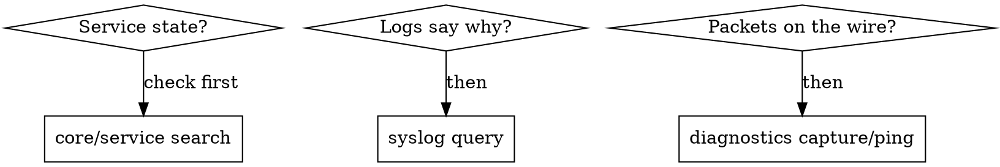

# opn-diagnostics (health/logs/traffic, OPNsense-only)

## Overview

Read-only first: `diagnostics` (ping, traceroute, DNS lookup, ARP/NDP,
packet capture, interface stats), `syslog` log files, `core/service`
states, System Health RRD graphs, NetFlow/Insight traffic analysis.
Retrieval-first: `docs.opnsense.org/development/api/core/{diagnostics,syslog,core}.html`
plus Reporting and Troubleshooting docs.

## When to Use

- Post-change verification, fault isolation, traffic forensics, capacity
  questions, pre-upgrade baselines.
- When NOT: making the change itself (→ sibling `opn-*` skills).

## Implementation

- Verify in layers: service running → config applied (rule counters move
  via `firewall/filter_util/rule_stats`) → logs confirm → packets confirm.
- Insight/NetFlow answers "who talked to whom"; packet capture answers
  "what exactly crossed"; never confuse the two.
- Baselines before upgrades and shaper/VPN changes so regressions are
  measurable (export the RRD/Insight window first).

## Common Mistakes

- Changing config to diagnose (diagnose read-only, then change once).
- Reading one log source while the answer sits in another (firewall vs
  resolver vs VPN logs).
- Capturing without a filter on a busy interface (noise, disk, missed
  packets).
- Treating a quiet log as proof of health — counters and captures decide.

## Reuses

`opn-firewall` (rule counters), `opn-system` (post-upgrade health).
