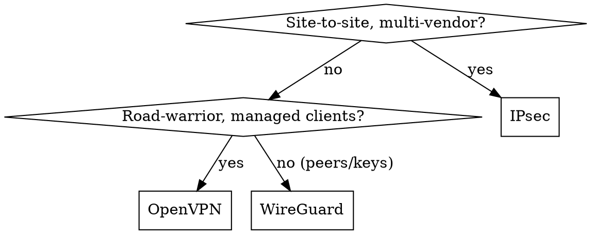

# opn-vpn (IPsec/OpenVPN/WireGuard, OPNsense-only)

## Overview

One module per tunnel type: `ipsec`, `openvpn`, `wireguard`. Same staged
model flow as the firewall: search → add/set → apply/reconfigure.
Retrieval-first: exact commands at
`docs.opnsense.org/development/api/core/{ipsec,openvpn,wireguard}.html`.

## When to Use

- Site-to-site or road-warrior tunnels, peer/instance CRUD, PSK/certificate
  rotation, tunnel up/down triage.
- When NOT: filter rules in front of tunnels (→ `opn-firewall`), reverse
  proxies (→ `opn-plugins` `haproxy`/`caddy`).

## Implementation

Per module: list/search existing instances first, `add`/`set` the peer or
server, then the module's apply/reconfigure step, then verify tunnel status
via the module's status endpoint and `opn-diagnostics`. Key material is
generated on the firewall or supplied per command — never stored in this
repo. GUI path mirrors the API 1:1, so unknown fields are copied from
browser devtools `/api/` traffic, not invented.

## Common Mistakes

- Hand-editing tunnel configs over SSH (bypassed by `config.xml`; lost on
  upgrade) — API/GUI only.
- Rotating keys without re-applying both ends' sessions.
- Opening tunnel ports in the wrong order: filter rules (→ `opn-firewall`)
  must pass IKE/WG/SSL ports before the tunnel can negotiate.
- Skipping the backup (→ `opn-system`) before rekeying production tunnels.

## Reuses

`opn-firewall` (tunnel port rules), `opn-system` (certs for IPsec/OpenVPN
via `trust`), `opn-diagnostics` (tunnel status/logs).
